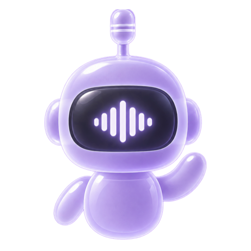
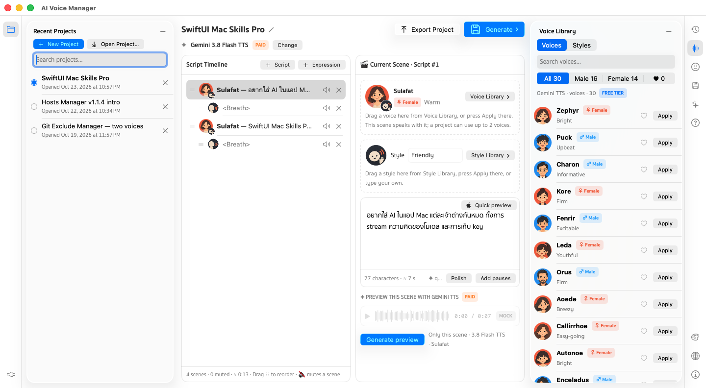

<p align="center">
  
</p>

# AI Voice Manager

A native macOS app for **AI voice-overs**: write a script scene by scene, listen free with the Mac's own voices while
you write, then generate the real take with **Gemini TTS** on your own API key. Projects save themselves and every
take is kept. Opens from Launchpad / Applications like any other app. In 12 languages.

**Website & download:** [gomin2013.github.io/ai-voice-manager](https://gomin2013.github.io/ai-voice-manager/)

<p align="center">
  
</p>

Same window layout as [Hosts Manager](https://github.com/gomin2013/hosts-manager) and
[Git Exclude Manager](https://github.com/gomin2013/git-exclude-manager) — if you use one, you already know the others.

## Features

- **Projects that keep themselves** — Recent Projects on the left; each project is a folder in
  `~/Library/Application Support/AI Voice Manager` and saves on every change. Rename with a double-click or ✎
  (never empty); removing one moves it to the Trash, with Undo.
- **Script Timeline** — every line and every pause is a scene: drag to reorder, mute to leave it out of the take,
  a voice and a style per line, and two voices per take for a conversation.
- **Voice Library** — Google's whole Gemini TTS library, 2,000+ voices (the same as AI Studio), the 30 with portraits
  first; search, filter ♂ ♀, ♥ favourites, ✓ the voices in this project, language and pitch, plus 12 style
  presets. Drag onto a scene or press Apply.
- **Expressions** — breath, short / long pause, laugh, sigh, gasp, cough between lines, each repeatable up to ×10.
- **Listen before you pay** — **Quick preview** (the Mac's own voices, free, offline), **Generate preview** (one
  scene with Gemini), then **Generate** for the whole take, saved as a WAV next to the timeline that made it.
- **Results** — every take with its waveform: play, download the WAV, bring its timeline back, delete with Undo.
- **Costs in plain sight** — Free tier or Billing on; with billing on the price shows in US dollars and your
  currency, and every paid take asks first.
- **AI Agent (optional)** — pick who answers in AI Providers › AI Agent: **Apple** Foundation Models or **Ollama**
  on your Mac, or **OpenAI**, **Gemini** (your Google key) or **Claude** with your key. **Polish** and **Add pauses**
  rewrite one scene (one step in History; not with Apple), and the chat answers about the whole project as it
  streams in — with the model's thinking, Markdown and Stop.
- **Internet alerts** — offline, back online, slow, fast again; Generate and previews are disabled while offline.
- **History** — two tabs of 30: **Script** keeps the project's edits, named after what changed (pin versions to keep
  them — the project as opened is pinned for you); **Scene** keeps the text versions of each scene, recorded when you
  pause typing, so deleted words come back. Double-click one to go back — going back is a step too, so nothing is lost.
- **Export / Open** — one `.avmproject.zip` with every take, to carry a project to another Mac.
- **Tool windows** — Recent Projects · AI Providers on the left; History · Voices · Expressions · Generate ·
  AI Agent · Help, plus Appearance · Language & Currency · About on the right; ⌥⌘1…0, one panel per side.
- **Your look** — Liquid Glass on macOS 26, Sukhumvit Set type, light / dark / system, 16 accent colours and
  8 gradient themes.
- **Keyboard** — ⌘N new project, ⌘↵ generate, Return / Esc save or cancel a rename, ⌘W / ⌘Q close and quit.

## Install

### Download (recommended)

1. Download `AIVoiceManager-x.y.z.dmg` from [**Releases**](../../releases/latest)
   (optionally verify it: `shasum -a 256 -c SHA256SUMS.txt`).
2. Open the DMG and drag **AI Voice Manager** to **Applications**. There is no helper and nothing else to install.
3. **First launch** — the app is not notarized by Apple (no Developer ID yet), so macOS blocks it once:
   - Open it, click **Done** on the warning, then go to **System Settings → Privacy & Security**,
     scroll to *"AIVoiceManager" was blocked* and click **Open Anyway**; or
   - in Terminal: `xattr -dr com.apple.quarantine "/Applications/AIVoiceManager.app"`
4. **Add your Gemini API key** (below).

### Build from source

Requires macOS 14+ and Xcode 16+ (Swift 6; Xcode 26 to regenerate the macOS 26 icon).

```bash
git clone https://github.com/gomin2013/ai-voice-manager.git && cd ai-voice-manager
swift build && swift test
scripts/build-app.sh && cp -R build/AIVoiceManager.app /Applications/ && open /Applications/AIVoiceManager.app
```

Apps you build yourself are not quarantined, so there is no Gatekeeper prompt.

### Add your Gemini API key

Create a key in [Google AI Studio](https://aistudio.google.com/apikey), open **AI Providers** (left rail, bottom),
paste it, press **Save**, then **Test connection**. Pick **Free tier** or **Billing on** to match the key's Google
project. The key stays in your Keychain and is only ever sent to Google.

Optional, for Polish, Add pauses and the AI Agent: open **AI Providers › AI Agent** and pick a provider —
**Apple** (on-device, macOS 26 with Apple Intelligence), **Ollama** (install [Ollama](https://ollama.com), then
`ollama pull qwen3.8 && ollama serve` and press **Check again**), **Gemini** (uses the key above), or **OpenAI** /
**Claude** (paste a key; it's kept in your Keychain).

### Uninstall

1. In **AI Providers**, press **Remove key** (and remove any OpenAI / Claude key under AI Agent), then quit the app.
2. Move `/Applications/AIVoiceManager.app` to the Trash.
3. Optional: delete `~/Library/Application Support/AI Voice Manager` (your projects and takes) and run
   `defaults delete com.aivoicemanager.app` (settings).

## How it works

```
AIVoiceManager.app (one process, no helper)
  ├─ projects ──▶ ~/Library/Application Support/AI Voice Manager/Projects/<id>/
  │                 project.json · Takes/<date>/take.wav + take.json
  ├─ Generate ──▶ Gemini TTS (generativelanguage.googleapis.com), your key from the Keychain
  │               unmuted scenes in → WAV 24 kHz mono out
  ├─ Polish / AI Agent ──▶ the provider you pick: Apple Foundation Models or Ollama (localhost:11434) stay on
  │                         your Mac; OpenAI, Gemini or Claude get the question + script, with your key
  └─ Quick preview ──▶ the Mac's own voices (AVSpeechSynthesizer, offline)
```

Takes are plain files Finder can read. Nothing goes to Google until you press Generate or Generate preview.

## Project layout

```
Sources/AIVoiceManagerApp/Models/      timeline, request body, import cleaning, catalogs, WAV — pure, tested
Sources/AIVoiceManagerApp/Services/    Gemini TTS, Keychain, project files + zip, Ollama, connection monitor
Sources/AIVoiceManagerApp/ViewModels/  the editor, History, playback
Sources/AIVoiceManagerApp/Views/       SwiftUI views and the Gomin shell (tool windows, settings)
Sources/AIVoiceManagerApp/Art/         paper-collage voice portraits, expression and style icons
Sources/AIVoiceManagerApp/Resources/   strings in 12 languages
Tests/AIVoiceManagerTests/             XCTest (75+)
scripts/build-app.sh                   assembles + ad-hoc signs build/AIVoiceManager.app
scripts/make-dmg.sh                    build/AIVoiceManager-<version>.dmg for Releases
scripts/make-icon.swift                Packaging/ icons and mascot from the renders in Packaging/source/
scripts/make-og-image.swift            docs/assets/img/og-image.png
scripts/make-th-page.py                docs/th/index.html from docs/index.html
.prototype/                            HTML reference design (open .prototype/index.html)
docs/                                  the website (GitHub Pages, 12 languages)
```

**Releasing:** bump `CFBundleShortVersionString` in `Info.plist`, date the top section of `CHANGELOG.md`, then
`git tag v1.2.3 && git push origin v1.2.3`. GitHub Actions builds the DMG and opens a **draft** release.

## Requirements

- An Apple silicon Mac with macOS 14 Sonoma or later, and an internet connection for Gemini
- A Gemini API key from Google AI Studio (the free tier works)
- Optional, for the AI Agent: Apple Intelligence (macOS 26), Ollama, or an OpenAI / Gemini / Claude key
- No third-party dependencies

## Privacy

No account with us, no telemetry, no server of ours. **Generate** sends the project's unmuted scenes (text,
expression tags, styles, speaker names, voices, model) from your Mac to Google's Gemini API with your own key;
**Generate preview** sends one scene. On the free tier Google may use that text and audio to improve its products.
The AI Agent sends your question and the project's script to the provider you pick — OpenAI, Google (Gemini) or
Anthropic (Claude), with your key — or keeps it on your Mac with Apple or Ollama. Quick preview stays on your Mac.
Details:
[Privacy Policy](https://gomin2013.github.io/ai-voice-manager/privacy-policy/).

## Troubleshooting

- **"Google refused the key"** — check the key in AI Providers, or that the Gemini API / billing is on for its
  Google project.
- **"Free-tier limit reached"** — wait, or turn billing on for the key's project.
- **"The AI Agent didn't answer"** — check AI Providers › AI Agent: for Ollama start `ollama serve` and press
  **Check again**; for OpenAI / Claude check the key and the model name.
- **Reset all app settings** — `defaults delete com.aivoicemanager.app` (projects stay in Application Support).

## Contributing

Issues and pull requests are welcome. Please add tests for new behaviour and make sure `swift test` passes.

## Support

AI Voice Manager is free. If it saves you time, you can [sponsor me on GitHub](https://github.com/sponsors/gomin2013).

## License

[MIT](LICENSE) © 2026 Watthajak Jinasam
